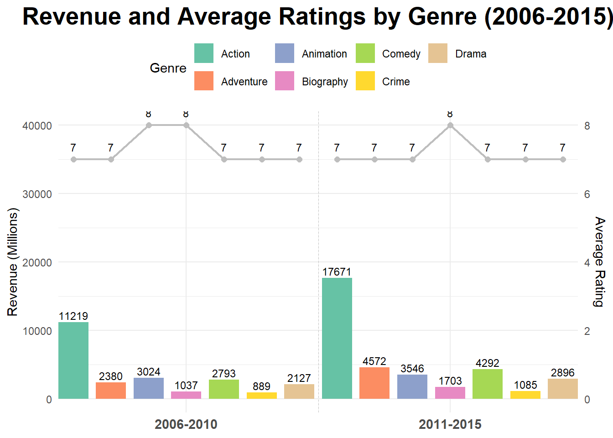

# Movie Revenue and Ratings by Genre (2006–2015)

A data visualization project built in **R and ggplot2**. It puts commercial performance and critical reception for seven film genres on a single chart, across two five-year periods, and uses the **data–task–idiom** framework to justify every design choice rather than picking a chart type by habit.



## The question

Which genres grew commercially between 2006–2010 and 2011–2015, and did audience ratings move with the money?

Those are two different kinds of quantity — dollars in the thousands of millions, and ratings on a 1–10 scale — and they have to be compared **per genre** and **across two time periods** at the same time. That is the whole design problem.

## The design, in the data–task–idiom framework

**1 · Data**
- Categorical: genre (Action, Adventure, Animation, Biography, Comedy, Crime, Drama)
- Quantitative: total revenue (millions) and average rating (1–10)
- Reshaped from wide to **long format** with `reshape2::melt`, so one column holds the metric name and another holds the value — the shape ggplot2 needs

**2 · Task**
- Compare revenue growth across genres between the two periods
- See whether ratings stayed stable while revenue moved
- Audience: someone deciding what to produce, who needs both signals at once

**3 · Idiom**
- **Bars for revenue** — length is the most accurate visual encoding for comparing magnitudes
- **A line with points for ratings** — connection implies continuity, which suits a value tracked across categories
- **A dual axis**, with ratings scaled by ×5000 to share the revenue axis, and a secondary axis (`sec_axis(~./5000)`) that relabels it back to the real 1–10 scale, so nobody misreads it
- **A computed `Position` column** places the two periods side by side on one continuous axis, split by a dashed line, instead of using facets — so the eye travels directly from 2006–2010 to 2011–2015
- **ColorBrewer Set2**, a qualitative palette chosen because genre is a category with no order
- **Direct value labels** on every bar and point, removing the need to trace back to the axis

## What the chart shows

| Genre | 2006–2010 | 2011–2015 | Change |
| --- | --- | --- | --- |
| **Action** | $11,219M | **$17,671M** | **+58%** |
| Adventure | $2,380M | $4,572M | +92% |
| Comedy | $2,793M | $4,292M | +54% |
| Biography | $1,037M | $1,703M | +64% |
| Drama | $2,127M | $2,896M | +36% |
| Crime | $889M | $1,085M | +22% |
| Animation | $3,024M | $3,546M | +17% |

- **Revenue rose in every genre; ratings barely moved**, sitting at 7–8 throughout. Audiences did not start liking films more — they spent more.
- **Action dominates**, at $17.7bn in 2011–2015 — almost as much as the other six genres put together ($18.1bn) — driven by the franchise era.
- **Adventure grew fastest** in percentage terms (+92%).
- **Animation grew the least** (+17%) while keeping among the highest ratings — well liked, but not where the box-office growth went.

The flat rating line is the point the dual axis was built to make: quality stayed constant while the money scaled.

## Honest note on the dual axis

Dual-axis charts are easy to abuse, because the scaling factor can make any two series look correlated. Here it is deliberate and defensible: the scaling is stated in the code, the right-hand axis is labelled in real rating units, and the conclusion drawn from it is that the two series **do not** track each other. The alternative — two stacked panels sharing an x-axis — would be the safer choice if this were going to a general audience.

## Tech stack

R · ggplot2 · reshape2 · RColorBrewer · R Markdown (knitr)

## Repository layout

```
src/revenue_by_genre.R         the ggplot2 chart, 75 lines
images/                        the exported chart
docs/rendered_report.html      the knitted R Markdown report
docs/Project_1_Report.docx     written report: data-task-idiom analysis
docs/Visualization_Presentation.pptx   presentation slides
```

## Run it

```r
install.packages(c("ggplot2", "reshape2", "RColorBrewer"))
source("src/revenue_by_genre.R")
```

---
**Author:** Nikhil Chhatraband · Data Visualization course project, Master's in Data Science
**Team:** Bhavana, Lokesh, Nikhil · November 2024
